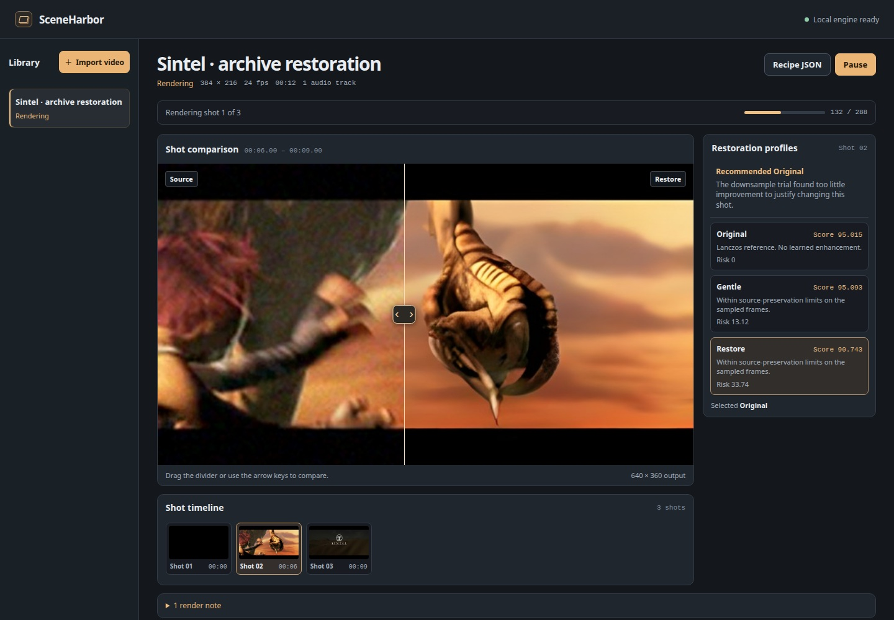

# SceneHarbor

**Review and restore uneven video, one shot at a time, on your own GPU.**

Old exports often mix clean footage, low-resolution inserts, and heavily compressed shots. A single aggressive AI pass can soften a good shot while rescuing another. SceneHarbor tests Real-ESRGAN on representative frames of each shot, shows the actual candidates side by side, and renders the choices you approve.

[中文说明](docs/README.zh-CN.md) · [Reference benchmark](docs/benchmark.md) · [Releases](https://github.com/iyuzhang/sceneharbor/releases)



*Shown with the Sintel teaser © Blender Foundation, CC BY 3.0. The preview is a derivative. [Attribution](NOTICE.md)*

## Install

Requires **Linux x86-64**, Python 3.11+, FFmpeg 6+ with libx264 and ffprobe, and a working Vulkan GPU driver. Install FFmpeg and the driver through your distribution.

```sh
uv tool install 'git+https://github.com/iyuzhang/sceneharbor.git@v1.0.0'
sceneharbor install-engine
sceneharbor doctor
sceneharbor serve
```

Open **http://127.0.0.1:8752**. You can also install the wheel attached to the release using `uv tool install ./sceneharbor-1.0.0-py3-none-any.whl`. The engine command downloads a pinned upstream release once. After setup, restoration runs offline.

Download `showcase.mp4` from the release to try the workbench on a 12-second public clip. Import it at 360p to keep the first run short.

For an offline machine, copy the [pinned upstream engine ZIP](https://github.com/xinntao/Real-ESRGAN/releases/download/v0.2.5.0/realesrgan-ncnn-vulkan-20220424-ubuntu.zip) to it and run `sceneharbor install-engine --archive /path/to/realesrgan-ncnn-vulkan-20220424-ubuntu.zip`. The installer verifies the same SHA-256 for downloaded and local archives.

## Restore a video

1. Import an MP4, MOV, MKV, WebM, AVI, MPEG, or TS file. Use an absolute path for large local files to avoid the extra copy. Choose the delivery height and quality.
2. Open a shot in the timeline. Drag the comparison divider to see the same frame with ordinary Lanczos scaling, a 35% neural blend, or full Real-ESRGAN. Inspect the suggestion, then keep it or choose a different treatment.
3. Render and download the MP4 and its JSON recipe. Pause long jobs and resume from complete segments. If you change one treatment after export, the next render reuses the verified segments for the unchanged choices.

Shot analysis runs a reduced-resolution AI trial against the source frame and checks changes on real candidate output. It looks at structure, luma, and low-motion instability. At native size it asks for evidence of reduced block artifacts before recommending an intervention. Scores help triage review. Inspect text, faces, line art, and motion yourself.

## Run a queue from the terminal

```sh
sceneharbor batch --height 1080 recording-a.mp4 recording-b.mp4
sceneharbor jobs
sceneharbor batch --resume JOB_ID
sceneharbor batch --recipe sceneharbor-recipe.json recording-a.mp4
```

Batch mode exports recommendations without waiting for shot review. Supply a saved recipe to replay the selected treatments against a matching source and engine. For a separate workspace or compatible model executable, place global options before the command.

```sh
sceneharbor --workspace /path/to/projects --gpu 0 --tile 256 serve --port 8752
sceneharbor --engine /path/to/realesrgan-ncnn-vulkan doctor
```

The default workspace is `${XDG_DATA_HOME:-$HOME/.local/share}/sceneharbor/workspace`. One service or batch worker may use a workspace at a time. Imported paths must remain readable and unchanged through export. Project files, checksummed checkpoints, and the output live in the workspace. Removing a job deletes those files and the uploaded copy, if any. Files imported by path remain in their original location.

## Media and quality

The input contract is progressive, constant-frame-rate, SDR video. Convert interlaced, HDR, or variable-rate footage before importing. Output is H.264 MP4 with source frame rate, display aspect ratio, audio tracks, and chapters. Audio is copied where the MP4 container supports the codec. Other audio tracks are encoded as AAC. Keep the source for subtitle streams and container attachments.

Real-ESRGAN is a frame-wise model and can invent texture or flicker. Save the original as your archive master. Review mode is useful when footage needs distinct treatments or when a person needs to approve the changes. A single fixed pass is simpler for uniformly degraded footage. See the benchmark for measured tradeoffs.

SceneHarbor binds to loopback and is intended for a single local operator. Restoration sends no footage or frames to an API. Set the workspace and system temporary directory on a disk with space for previews, checkpoints, and bounded inference batches.

## License

MIT. See [third-party notices](NOTICE.md) for the engine and sample footage.
